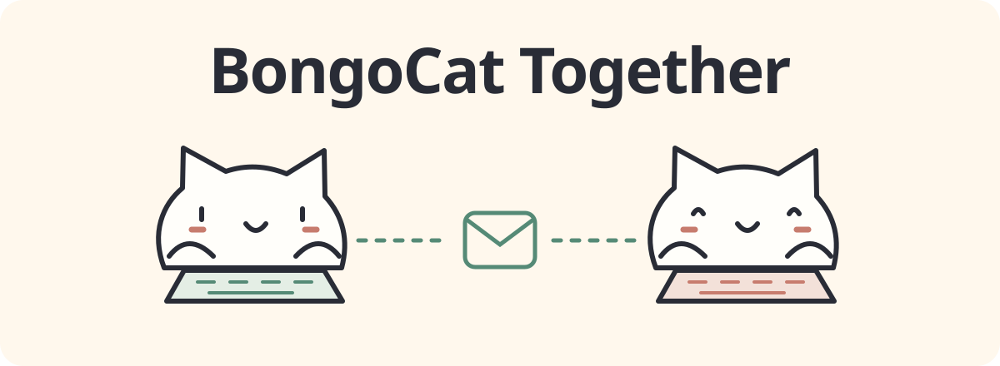

<p align="center">
  
</p>

# BongoCat Together

**桌面上多一只猫，也多一位一起敲键盘的朋友。**

[English](README.md) · 简体中文 · [使用说明](docs/bongocat-together-usage.zh-CN.md)

基于 [BongoCat](https://github.com/ayangweb/BongoCat) 的 Windows 开发版本，增加可选的双人加密房间。
保留自己的桌宠，在旁边显示好友的猫，分别选择是否分享键盘活动、鼠标动作，以及专用输入框中的文字。

**开发版 · Windows x64 · [Together Release](https://github.com/heyhex/BongoCat-Together/releases) 提供开发测试包。**

## 一个邀请码，两只独立的猫

1. **创建房间**，把邀请码私下交给一位好友。
2. **加入房间**，显示模型、大小和位置都可独立设置的好友猫。
3. **选择分享内容**。所有分享默认关闭，分享时有持续可见的指示和停止按钮。

无需注册账号，也无需自行部署服务器。连接通过 Iroh 使用加密 QUIC，可能借助公共发现与中继服务。
仅直连模式禁用中继，需要可达的 UDP 路径。本地桌宠仍可离线使用。

| 可以分享什么 | 好友会收到什么 |
| --- | --- |
| 抽象键盘活动 | 是否正在按键，不包含具体键码 |
| 具体键位 | 物理按键的按下、释放和组合 |
| 鼠标动作 | 归一化移动、按键与滚轮方向 |
| 专用输入框文字 | 仅主动输入到分享框的内容，不读取其他软件文字或剪贴板 |

远端输入只驱动好友猫，不会控制对方电脑。文字气泡会自动消失，分享的键位和文字不写入历史或日志。
具体按键序列可能透露输入内容；按需开启，也可限制在指定前台应用中分享，结束时点击停止。

## 从源码体验

准备 **Windows 10 1903+ x64**、使用 **MSVC** 工具链的 Rust、带 Windows SDK 的 Visual Studio C++
生成工具，以及 [just](https://github.com/casey/just)。保留仓库中的模型和厂商资源目录。

```powershell
git clone https://github.com/heyhex/BongoCat-Together.git
cd BongoCat-Together
$env:RUSTUP_TOOLCHAIN='1.97.1-x86_64-pc-windows-msvc'
just dev
```

当前仓库已公开。双方可安装 Together 测试包或各自运行源码工作区，从托盘打开设置，进入「好友联机」，
创建或加入房间，再开启需要的分享。邀请码用于首次加入的期限为十分钟，重连后分享恢复关闭。

开发数据与已安装的 BongoCat 生产版隔离。自行构建的程序依赖工作区资源，不是可单独复制的便携包。
连接、模型与分享的详细操作见[完整使用说明](docs/bongocat-together-usage.zh-CN.md)。

## 检查更新

通过托盘或「设置 → 关于」点击「检查更新」。只检查
[heyhex/BongoCat-Together](https://github.com/heyhex/BongoCat-Together/releases)，
包含预发布版；有更新且存在对应 Windows x64 安装包时，可打开对应 Release 页面下载。
自动检查沿用现有开关与检查间隔。下载和安装由用户手动完成，不提供自动安装。
已发布的 0.1.0 安装包尚不包含此功能，请安装 0.1.1 或后续版本。

## 给好友的猫留个位置

可以选择本地模型、调整缩放、隐藏好友猫、交换双猫位置或重置布局。可用的内置模型会自动匹配；
自定义模型需在双方电脑分别导入，连接不会传输模型文件。

更多模型可在 [Awesome-BongoCat](https://github.com/ayangweb/Awesome-BongoCat) 浏览，使用时请遵守各模型许可。
滚轮方向会显示在气泡中；滚轮和双击的专属动画取决于模型支持。

## 已验证与待验收

Windows 自动化检查覆盖真实本机 QUIC 连接、分享权限撤销、独立双猫运行、模型切换与失败恢复、
文字气泡、断线清理，以及 800 × 600 和 1000 × 600 下的好友联机页布局。

```powershell
just check
just together-smoke
just dev-smoke
```

**仍待真实环境验收：** 不同公网的两台电脑、中继与网络切换、中文输入法组合输入、物理键鼠及锁屏/睡眠/UAC、
125/150/200% DPI 与跨屏，以及连续八小时稳定性。

好友显示偏好和应用白名单目前仅在本次进程内保留；气泡样式跟随应用主题。macOS 尚未实现 Together，
部分其他语言的联机文案暂用英文。签名、安装升级卸载测试和再分发核对仍待完成。

## 致谢与许可

基于 [ayangweb/BongoCat](https://github.com/ayangweb/BongoCat)，灵感来自
[MMmmmoko/Bongo-Cat-Mver](https://github.com/MMmmmoko/Bongo-Cat-Mver)。保留上游提交历史和许可声明。
原项目的已发布版本不包含本仓库的 Together 开发功能。

应用代码采用 [Apache License 2.0](LICENSE)。Live2D Cubism Core 与模型资源遵循各自许可，
详见仓库内的 [Cubism 许可](vendor/cubism/5-r.5/LICENSE.md)与[声明](vendor/cubism/5-r.5/NOTICE.md)。

参与修改前请阅读[贡献指南](CONTRIBUTING.zh-CN.md)。
